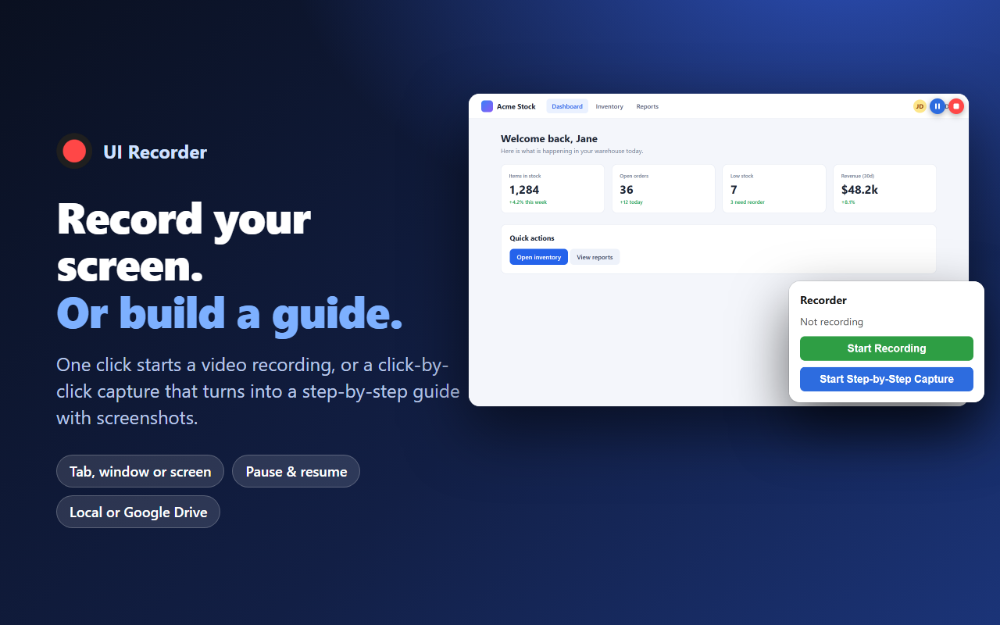
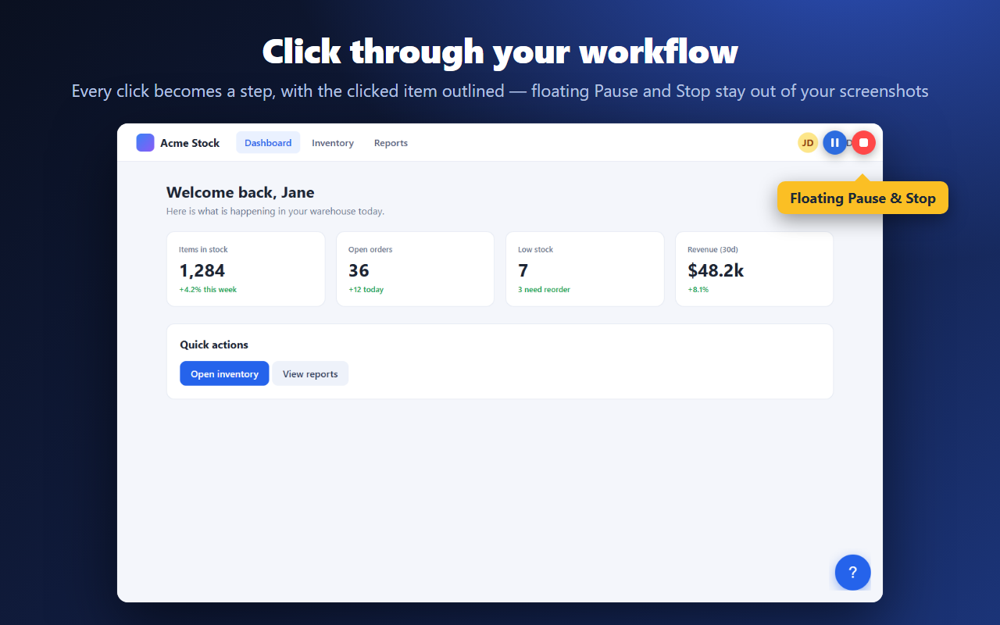
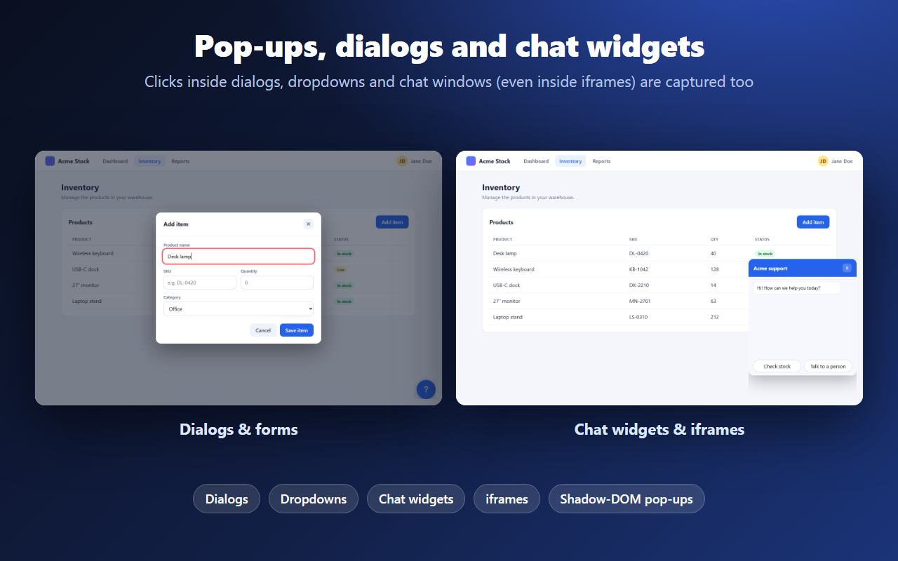
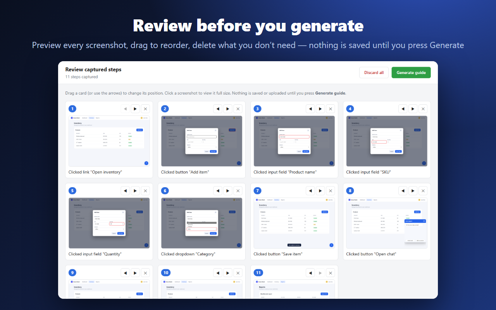
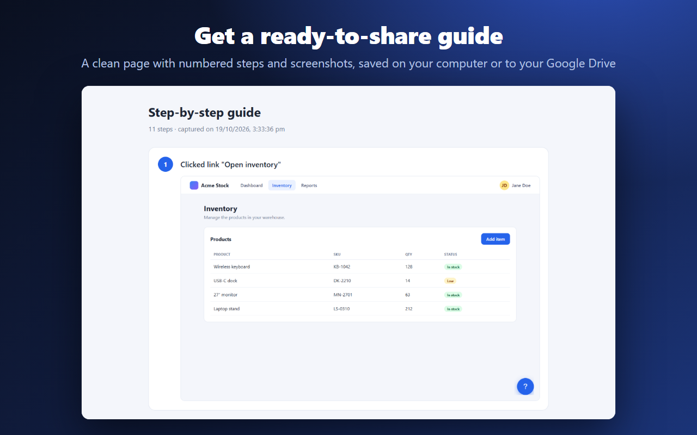

# UI Recorder — Product Introduction

Everything in the "paste-ready" blocks below can be copied straight into the Chrome Web Store dashboard
(Store listing tab).

---

## Name

**UI Recorder: Screen & Step Guide Maker** (38 characters, limit 75)

> The manifest `name` is shown in the browser toolbar. The store listing name is taken from the manifest at
> upload time, so change `"name"` in `manifest.json` if you want this longer name to appear.

## Short description (paste-ready, max 132 characters)

```
Record your screen as video, or click through any workflow and get a step-by-step guide with screenshots.
```
(105 characters. This is also the manifest `description`.)

## Category

Productivity (alternative: Workflow & Planning)

## Language

English

---

## Detailed description (paste-ready)

```
UI Recorder turns any workflow into a video or a ready-to-share, step-by-step guide — in two clicks.

Two ways to capture:

● START RECORDING — record a browser tab, an application window, or your entire screen to a video file (.webm). Pause and resume whenever you like, so the video only contains what matters.

● START STEP-BY-STEP CAPTURE — just click through the process you want to document. UI Recorder takes a screenshot of every click, highlights exactly what you clicked, and writes a plain-English description such as "Click Save" or "Click Email". When you finish you get a numbered, printable guide with one screenshot per step.

WHY PEOPLE USE IT
• Write a how-to guide, SOP or training document in minutes instead of hours
• Show a colleague or customer exactly where to click
• Report a bug with reproducible, annotated steps
• Record a quick demo or walkthrough video without installing desktop software

BUILT FOR REAL-WORLD WEBSITES
• Waits for the page to finish loading before taking a step's screenshot — no half-loaded, blank pages
• Captures pop-ups, modal dialogs, cookie banners and drawers that open after a click
• Captures chat widgets and embedded content that live inside iframes
• Works on single-page apps (React, Vue, Angular) as well as classic multi-page sites, and follows you as you navigate between pages

REVIEW BEFORE YOU PUBLISH
When you stop a step capture, a review page opens first. Check every screenshot, drag steps into a new order, delete the ones you don't need (with undo), zoom in to inspect any image, and only then generate the guide.

SIMPLE CONTROLS
• One small, translucent control sits on the page while you record: Pause/Resume and Stop. It is hidden from your screenshots.
• Prefer the keyboard? Press Esc to stop.
• Your steps are saved as you go, so an accidental tab close does not lose your work.

YOUR DATA STAYS WITH YOU
• Everything is saved to your own computer (Downloads/recordings).
• Nothing is uploaded to the developer or to any third party.
• No account, no sign-up, no ads, no tracking.
• Text you type into fields is never recorded, and passwords are never captured as text.

WHAT YOU GET
Video:   Downloads/recordings/recording-<date>.webm
Guide:   Downloads/recordings/steps-<date>/index.html + step-01.png, step-02.png …
Open index.html in any browser, print it to PDF, or zip the folder and send it to a colleague.

GOOD TO KNOW
• Step capture records the tab you started it in. Browser pages such as chrome:// pages and the Chrome Web Store itself cannot be captured (a Chrome restriction).
• Pressing Esc stops the capture, so use the on-page close button to dismiss pop-ups while recording.
• Step capture records clicks; it does not record what you type.

Questions or feedback? Contact: <YOUR SUPPORT EMAIL>
```

> If you ship the Google Drive option (see `STORE_SUBMISSION.md`), add this paragraph after "YOUR DATA STAYS WITH YOU":
>
> ```
> OPTIONAL GOOGLE DRIVE BACKUP
> Turn on "Also save to Google Drive" and every recording or guide is also copied to a folder in YOUR Google Drive. UI Recorder can only see the files it creates itself — never the rest of your Drive. Off by default.
> ```
> and change "Nothing is uploaded to the developer or to any third party" to
> "Nothing is sent to the developer. Files go to Google Drive only if you turn that on."

---

## Feature highlights (for the "features" section / promo copy)

| Feature | One-liner |
|---|---|
| Video recording | Tab, window or full screen to a `.webm` file |
| Pause / Resume | Skip the boring parts, on-page, one click |
| Step-by-step capture | One screenshot per click, auto-numbered |
| Click highlight | A clear box around exactly what you clicked |
| Plain-English captions | "Click Save", "Click Email", "Click Close" — generated for you |
| Waits for the page | No more blank, half-loaded screenshots |
| Pop-ups, dialogs, chat | Captured too, including chat widgets inside iframes |
| Review page | Reorder, delete, undo, zoom — then generate |
| Local by default | Saved to your Downloads folder, no account needed |

## Who is it for

- **Support & success teams** writing help-centre articles and customer instructions
- **IT & operations** documenting procedures (SOPs) and onboarding steps
- **Trainers & HR** building how-to material for new joiners
- **QA & developers** attaching clear reproduction steps to bug reports
- **Anyone** who has ever typed "first click here, then click there…" into an email

## How it works (three steps)

1. **Choose** — click the toolbar icon, then *Start Recording* or *Start Step-by-Step Capture*.
2. **Do the task** — work as you normally would. A small Pause/Stop control floats on the page.
3. **Stop and share** — stop the capture; for guides, review the steps, then *Generate guide*.

## Privacy at a glance

- Works entirely on your device. No servers, no accounts, no analytics.
- Only captures while you have started a capture and only the tab/window/screen you chose.
- Never records keystrokes or typed values; password fields are never read.
- Full policy: see `PRIVACY_POLICY.md` (host it at a public URL and paste the URL into the dashboard).

## FAQ

**Where are my files saved?**
In your browser's Downloads folder, inside a folder called `recordings`.

**Can I record my whole screen or another app?**
Yes — *Start Recording* uses Chrome's own sharing dialog, where you pick a tab, a window, or the entire screen. *Step-by-step capture* records the browser tab only.

**Why was my pop-up not recorded?**
Pressing Esc ends the capture, so closing a pop-up with Esc stops recording. Use the pop-up's close button instead. If a pop-up appears with no click at all (for example after a timer), it isn't a click step.

**Does it record what I type?**
No. Clicks are recorded; typed text is not, and password fields are never read.

**Does it record sound?**
Video recording captures tab/system audio when you tick "Share tab audio" / "Share system audio" in Chrome's dialog. Microphone input is not recorded.

**Can I edit the captions?**
The generated guide is a plain HTML file, so you can open it in any editor to change the wording.

**Why can't it record chrome:// pages or the Web Store?**
Chrome does not let any extension run on those pages.

**Is it free?**
Yes.

---

## Screenshots for the store listing

Upload these from `store/screenshots/` (1280 × 800, PNG). Order matters — the first is the hero image.

| # | File | Caption (optional) |
|---|---|---|
| 1 | `screenshot_1_record_or_capture.png` | Record video or capture steps — one click to start |
| 2 | `screenshot_2_every_click_a_step.png` | Every click becomes a highlighted, numbered step |
| 3 | `screenshot_3_dialogs_and_chat.png` | Pop-ups, dialogs and chat widgets are captured too |
| 4 | `screenshot_4_review_before_generate.png` | Review, reorder and delete before you generate |
| 5 | `screenshot_5_ready_to_share_guide.png` | A clean guide, ready to share or print |

Promotional images:

| Slot | File | Size |
|---|---|---|
| Small promo tile (required) | `promo_tile_small_440x280.png` | 440 × 280 |
| Marquee promo tile (optional) | `promo_marquee_1400x560.png` | 1400 × 560 |
| Store icon | `icons/icon128.png` | 128 × 128 |

Preview of the gallery:







> These screenshots show a fictional demo site ("Acme Stock"). Chrome Web Store policy asks that screenshots
> accurately represent the extension — they were produced by driving the real extension in a real browser.

## YouTube / promo video (optional)

If you add a video later, a 30–45 second screen recording of: start step capture → click through three pages →
open a dialog → stop → review → generate guide, works well.
