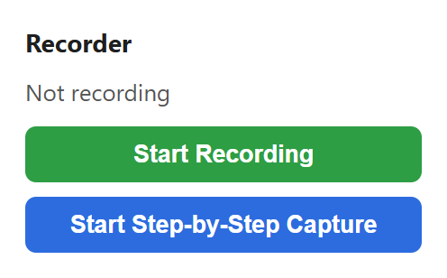
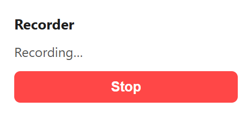
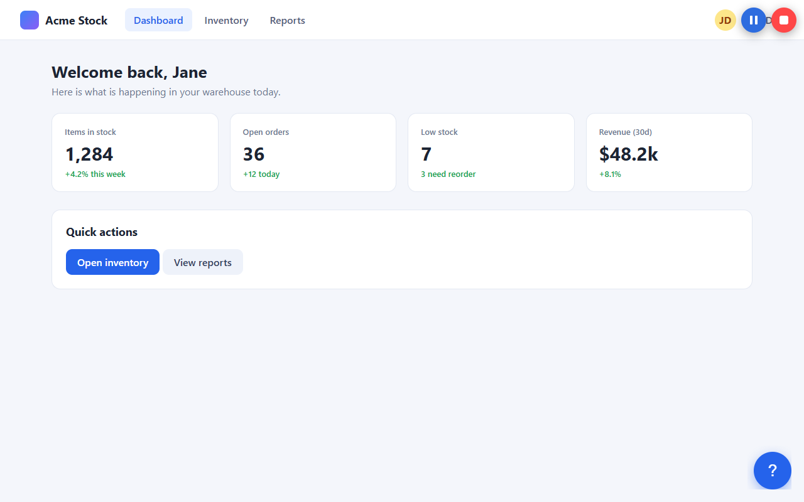
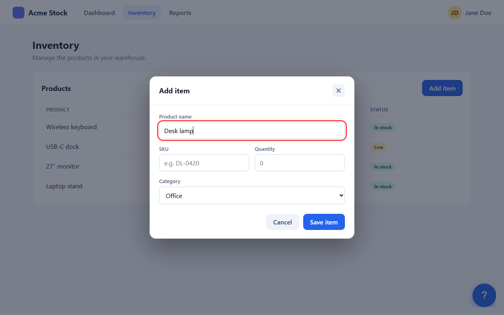
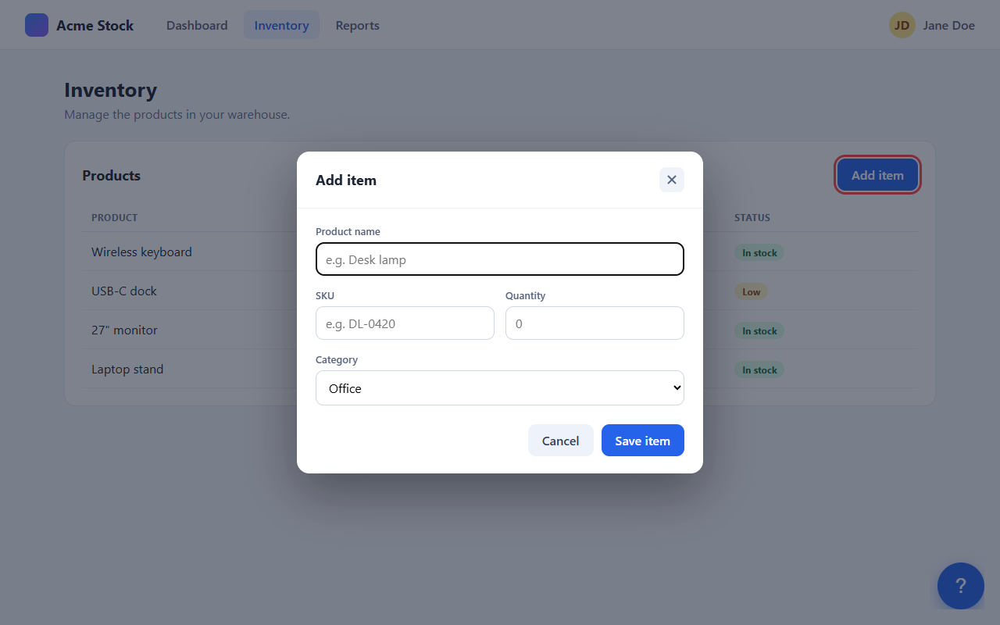
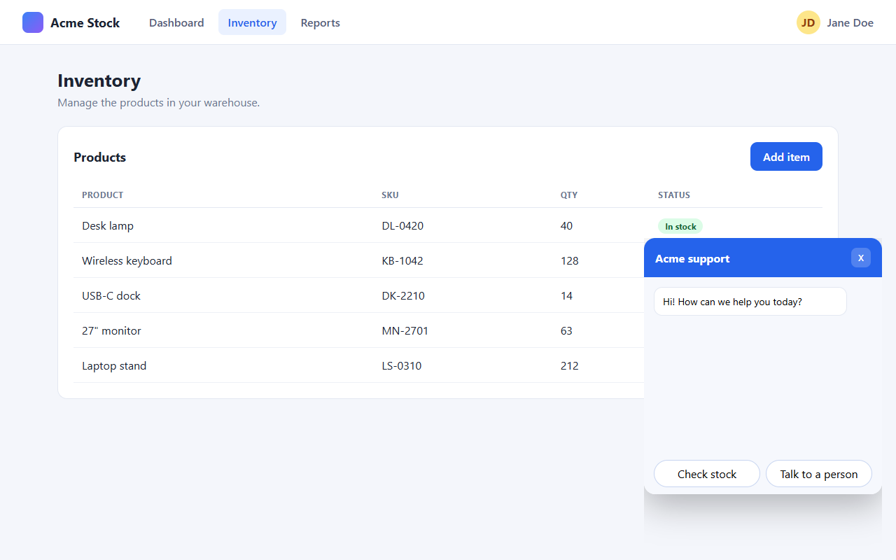
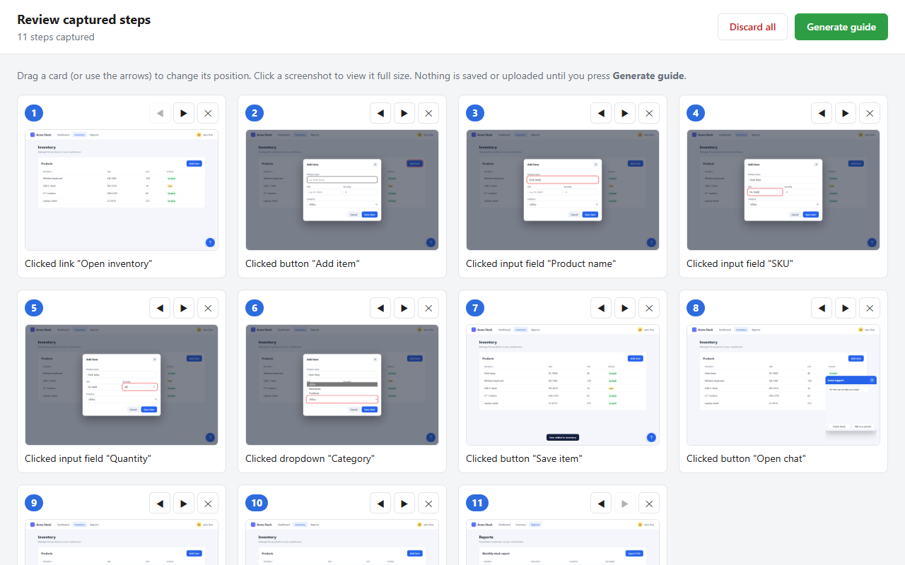
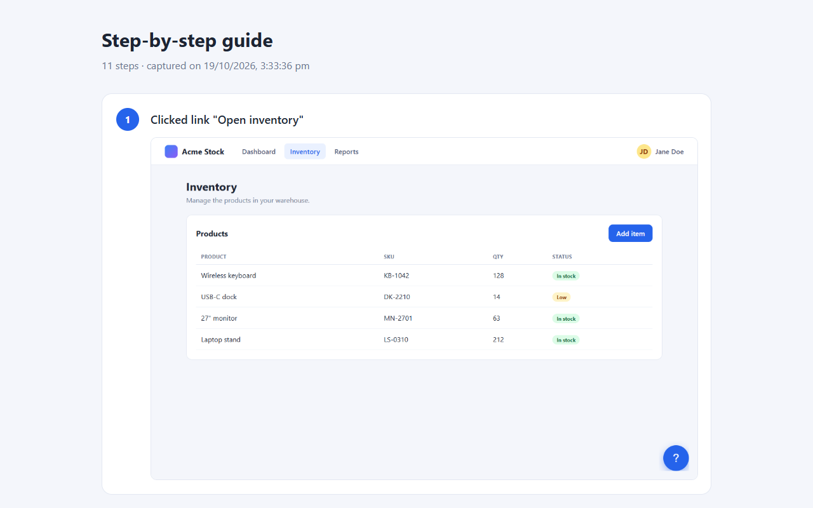

# UI Recorder — User Guide

UI Recorder does two things:

| | **Start Recording** | **Start Step-by-Step Capture** |
|---|---|---|
| Output | A video file (`.webm`) | A numbered guide: `index.html` + one PNG per step |
| Records | A tab, a window, or your whole screen | The browser tab you start it in |
| Best for | Demos, walkthroughs, meetings | How-to guides, SOPs, bug reports |

Contents: [Install](#1-install) · [Open the extension](#2-open-the-extension) · [Record a video](#3-record-a-video) · [Capture steps](#4-capture-a-step-by-step-guide) · [Review](#5-review-your-steps) · [Find your files](#6-find-your-files) · [Tips](#7-tips-for-great-guides) · [Limits](#8-things-to-know) · [Troubleshooting](#9-troubleshooting)

---

## 1. Install

1. Open the **Chrome Web Store** and search for **UI Recorder**.
2. Click **Add to Chrome**, then **Add extension**.
3. Click the puzzle-piece icon in the toolbar and **pin** UI Recorder so its icon is always visible.

No account or sign-up is needed.

## 2. Open the extension

Click the UI Recorder icon in the toolbar.



- **Start Recording** (green) — video of a tab, window or screen.
- **Start Step-by-Step Capture** (blue) — a screenshot for every click.
- **Review captured steps** (orange) — only appears when a step capture is waiting for you to review it.

While something is being captured, the menu changes to show the status and a **Stop** button:



## 3. Record a video

1. Click **Start Recording**.
2. Chrome asks **what to share**. Choose **Chrome Tab**, **Window** or **Entire Screen**, pick the one you want, and click **Share**.
   - To include sound, tick **Also share tab audio** (tab) or **Also share system audio** (screen).
3. Work as normal. A small floating control appears on the page:



   - **Pause / Resume** (blue) — hold the recording while you set something up, then continue. Paused time is not in the video.
   - **Stop** (red) — finish the recording. You can also press **Esc**.
4. When you stop, the video is saved automatically (see [Find your files](#6-find-your-files)).

> The floating buttons are semi-transparent so they stay out of the way; they brighten when you hover.
> When recording a window or the whole screen, the buttons appear on the page you started from. Use Esc or the
> toolbar menu's **Stop** if you are working in another application.

## 4. Capture a step-by-step guide

1. Open the page where your process begins.
2. Click the UI Recorder icon, then **Start Step-by-Step Capture**.
3. A small control (Pause · Stop) appears on the page. **Now just do the task** — click through it exactly as you normally would.
4. UI Recorder takes a screenshot **at every click**, draws a highlight box around the thing you clicked, and writes a caption such as *"Click Save"*.



What it handles for you:

- **Pages that are still loading.** If a click opens a new page, the screenshot of that step is taken once the page has finished loading — not while it is blank.
- **Pop-ups and dialogs.** When a click opens a dialog, drawer or cookie banner, the step shows it open.



- **Chat widgets and embedded content** inside iframes are recorded too.



- **Single-page apps and multi-page sites** — it keeps recording as you move between pages in the tab.

**Pause / Resume.** Click the blue **Pause** button on the page when you need to do something you don't want in the guide (for example, signing in). Click **Resume** to continue.

**Finish.** Click **Stop** on the page (or press **Esc**, or use **Stop** in the toolbar menu). Your steps are not exported yet — the review page opens next.

> **Privacy.** Only clicks are recorded. What you type is never stored, and password fields are never read.
> If a step's screenshot would show something sensitive, delete that step on the review page.

## 5. Review your steps

After you stop, the **review page** opens with every screenshot as a card.



| To… | Do this |
|---|---|
| **Reorder** | Drag a card to a new position (a blue bar shows where it will land), or use the **◀ ▶** buttons on the card |
| **Delete** | Click **✕** on the card. An **Undo** link stays for 8 seconds |
| **Zoom in** | Click the screenshot to see it full size. Press **Esc** or click again to close |
| **Generate** | Click **Generate guide** — the guide is written in the order shown, numbered 1, 2, 3 … |
| **Start over** | Click **Discard all** |

Your edits are saved as you make them. If you close the review tab by accident, open the toolbar menu and click **Review captured steps (N)** to come back to it. You can't start a new step capture until you have generated or discarded the pending one.

If a click could not be captured, the review page tells you before you generate, so you can fill the gap by re-capturing.

## 6. Find your files

Everything is saved in your browser's **Downloads** folder, inside a folder called **recordings**:

```
Downloads/
└── recordings/
    ├── recording-2026-10-19T07-35-27.webm     ← video recordings
    └── steps-2026-10-19T07-40-02/             ← one folder per guide
        ├── index.html                          ← double-click to open the guide
        ├── step-01.png
        ├── step-02.png
        └── …
```

The generated guide is a normal web page with the step number, caption and screenshot for each step:



To share it:

- **Print or save as PDF** — open `index.html`, press `Ctrl+P` (`Cmd+P` on Mac), and choose *Save as PDF*.
- **Send it** — zip the whole `steps-…` folder and email or upload it. Keep `index.html` and the PNGs together.
- **Edit the wording** — open `index.html` in any text editor and change the captions.

Videos play in Chrome, Edge, Firefox and VLC. To convert to MP4, use any free converter.

## 7. Tips for great guides

- **Click deliberately and wait a moment** after each click, so the screen can settle. One clean click per action works best.
- **Start on the right page.** Open the page and get logged in *before* you click Start.
- **Use Pause** for sign-ins, personal data or anything you don't want in the guide.
- **Close pop-ups with their close button**, not Esc (Esc stops the capture).
- **Keep the window a sensible size.** Screenshots are what the tab shows, so a normal-sized window gives readable pictures.
- **Review everything.** Delete accidental clicks and reorder before generating — that's what the review page is for.
- **Hide sensitive tabs/bookmarks** if recording a window or screen; video shows exactly what is on screen.

## 8. Things to know

- **Step capture records one tab** — the one you started it in. If a click opens a *new* tab or window, that new tab is not followed; go back to the original tab or start a new capture there.
- **Some pages can't be recorded.** Chrome does not allow extensions on `chrome://` pages, other extensions' pages, or the Chrome Web Store. Video recording of a whole screen or window still works.
- **Clicks only.** Typing, scrolling and hovering are not recorded as steps.
- **Esc stops the capture.** It is meant as a quick escape hatch, so it also triggers while you are closing pop-ups.
- **Screenshot speed limit.** Chrome allows about two screenshots per second to extensions. Very rapid clicking may be paced slightly; every click is still kept.
- **Long recordings** make large files — video quality is chosen by Chrome.

## 9. Troubleshooting

| Problem | What to try |
|---|---|
| Nothing happens when I click Start | Make sure you are on a normal web page (not `chrome://…` or the Web Store). Refresh the page and try again |
| The sharing dialog doesn't appear | It appears only for **Start Recording**. Step capture needs no dialog |
| My step screenshot is of the page before it loaded | Wait for the page to settle after a click before the next one. If a site keeps loading forever (live chat, analytics), the shot is taken after a short wait |
| A pop-up is missing | Make sure it opened as a result of your click. Close it with its own button, not Esc |
| I closed the review page by accident | Click the toolbar icon → **Review captured steps** |
| I can't start a new step capture | A previous capture is waiting — open it from the menu and **Generate** or **Discard** it |
| I can't find my files | Open your browser's Downloads page (`Ctrl+J`) and look in the `recordings` folder |
| The guide images look blurry | Use a normal-sized browser window; the guide shows the screenshot at its captured size |

Still stuck? Contact: **<YOUR SUPPORT EMAIL>**
